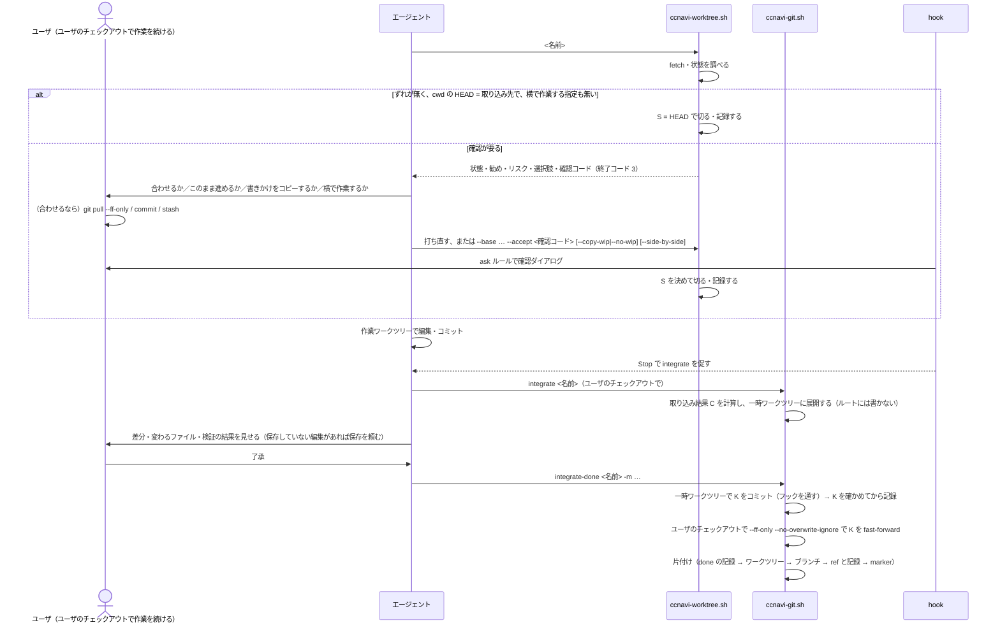

# 直接作業のユーザとエージェントの手順

直接作業は、チケットを起こさない調査・小さな修正。判定は全体ルールだけで、レビューはユーザが取り込み前の差分を見ることで行う。この文書の直接作業は MR を使わない。例外として、issue がある依頼をユーザが直接作業と明示したときは、成果を MR で受けて、`integrate` は打たない（[ticket-work.md](ticket-work.md) の「作業のパターン」の表の 4）。
チケット作業の手順は[ticket-flow.md](ticket-flow.md)。ワークツリーの一般的な決まりは[worktree.md](worktree.md)、取り込みの細部は[worktree-merge.md](worktree-merge.md)、片付けは[worktree-cleanup.md](worktree-cleanup.md)。
git は直接呼ばず `ccnavi-git.sh` を通す（生の git は常に止められる）。

## 方針

Claude Codeを起動したワークスペースで、ユーザのチェックアウトでは普段どおり作業を続ける。エージェントはワークツリーで作業し、終わったら成果を、起点にしたブランチ（取り込み先）へ 1 コミットで載せる。

- 取り込み先は、切った時点でユーザのチェックアウトが開いていたブランチで、記録に残す。統合先（`origin/HEAD`）とは別の概念で、pushの拒否・MRの宛先・チケットの起点は統合先のまま。途中でブランチが切り替わっていたら取り込みを断る。
- 確認している間、ユーザのチェックアウトのindexとワークツリーには書かない。最後に `--ff-only --no-overwrite-ignore` 付きのmergeで 1 コミットだけ載せる。ユーザの書きかけはgitが持ち越す。
- 作業ワークツリーは取り込みのために作り替えない。取り込み結果の検証とコミットは、一時ワークツリー（`logs/direct-tmp/`）で行う。
- リモートとのずれや書きかけがあれば、合わせることを勧めてリスクを示す。それでもユーザが進めると言えば、了承した状態のまま進める。
- ユーザが横で作業すると明示した間（`--side-by-side`）は、ユーザのチェックアウトで見つかった変更を自動復元で戻さず、報告にする。ccnaviの設定ファイルは戻す。

## ユーザ確認までの進め方

- 判断に必要な質問・問題がない限り、ユーザ確認地点まで作業を続ける。「次へ進めてよいか」だけの確認では止まらない。ユーザが停止・待機・相談を求めた場合や、操作が拒否された場合は止まり、理由を報告する
- 調査のみで変更がなければ、結果を報告して終える
- 変更がある場合は、実装と検証を終えてからコミットし、取り込み先が進んでいれば取り込む（手順 4）。そのあと `integrate` の前に、次のレビューを済ませる。レビューのためにターンを終えない。
  1. haiku のサブエージェントに、差分を敵対的にレビューさせる。誤り・抜け・壊れる条件に加えて、もっと単純に書けないか、共通化して今後の拡張・修正をしやすくできないかも見させる
  2. 別の haiku のサブエージェントに、1 の指摘をフラットに評価させる。まれな異常状態のために処理を複雑にしていないか、1 の指摘が作り込みを求めていないかも評価させる
  3. 取り入れる指摘は、新しいコミットで直す（`--amend` は拒否される）。取り入れない指摘は理由を残す

  1・2 には対象の差分を渡し、2 には 1 の指摘も渡す。どちらも読むだけで、編集させない。
- レビューを済ませたら `ccnavi-git.sh integrate <名前>` まで進め、取り込み結果の差分・変わるファイル・検証結果をユーザに見せる。あわせて、`integrate-done` の前に次の 4 つを見せる。修正の背景と前提知識、今回の修正内容、取り入れたレビュー指摘、取り入れなかったレビュー指摘（理由つき）。変わるファイルに未保存の編集があれば、このとき保存してもらう。
  - 対話のセッション: 見せたら、ターンを終えず続けて `integrate-done` を打つ。出るユーザの確認で許可されたら同じターンで確定する（サブエージェントが打つ形は、対話でも非対話の扱い）。
  - 非対話のセッション: 見せたら、返事を待ってターンを終える。`integrate` のあとのユーザの発言があるまで `integrate-done` は打てない（同じ発言の中で「取り込んで」と頼まれていても、もう 1 往復になる）。了承を得たら `integrate-done` で確定する。
  - issue がある依頼を MR で受けるときは、この手順を使わず、[ticket-work.md](ticket-work.md) の表の 4 に従う。

対応範囲は、ワークスペース自身と、通常の `.git` を持つプロジェクトのclone。Claude Codeを起動する場所は2通りある。ワークスペースで起動したときは、プロジェクトの作業を `cd projects/<名前>` して行う。プロジェクトのディレクトリで起動したとき（そのリポジトリだけをcloneした単体cloneを含む）は、そこで作業する。どちらも対象で、使い方の前提は要件書の「想定する使い方」にある。gitは 2.40 以上（`merge-tree --merge-base` を使うため）。

## 置き場

プロジェクト `p` の作業の例。ワークスペース自身の作業では、`<repo>` が `self`、ユーザのチェックアウトが `/ws` になる。

| 対象 | 場所 |
|---|---|
| 道具・実行ファイル | `/ws/.ccnavi/…` |
| ユーザのチェックアウト | `/ws/projects/p` |
| 作業ワークツリー | `/ws/.claude/worktrees/<名前>` |
| 一時ワークツリー | `/ws/logs/direct-tmp/<repo>/<名前>`。`logs/` はgitが無視するので、検証で書かれるファイルが止められない |
| 直接作業の記録 | 対象リポジトリのgitの共通ディレクトリの `ccnavi-direct/<名前>` |
| 取り込み中のmarker | ユーザのチェックアウトのgitディレクトリの `ccnavi-integrate/<名前>/marker` |
| 取り込み済みの記録 | 同じく `ccnavi-integrate-done/<名前>` |
| 専用のref | `refs/ccnavi/direct/<名前>/{pending,s,t,c,k}`。作業の途中のコミットをgcから守る |
| ロック | `/ws/logs/state/locks/<repo>/.integrate` |

どの操作（切る・取り込み・確定・abort）も、最初に共通の前提を確かめる。実行した場所・ユーザのチェックアウト・作業ワークツリー・一時ワークツリーの `git rev-parse --git-common-dir` の実パスが、記録の `common_dir` と同じであること。違えば断る。

## 全体の流れ

## 用語

| 用語 | 意味 |
|---|---|
| ユーザのチェックアウト | そのリポジトリの `git worktree list` の先頭。`/ws` か `/ws/projects/<名前>` |
| 取り込み先 | 切った時点でユーザのチェックアウトが開いていたブランチ |
| S（起点） | `--copy-wip` を選んだときは、確認した時点の書きかけを含むスナップショットのコミット。それ以外は記録したHEAD |
| T | 作業ブランチの先頭の木から、`wip/handoff/` の差分をSの中身に戻したもの |
| C | `merge-tree --write-tree --merge-base=S HEAD T` の結果の木。HEADにエージェントの変更だけを足したもの |
| K | Cの木を持ち、HEADを親とするコミット。一時ワークツリーでフックを通して作る |
| 有効な横で作業する記録 | `side_by_side yes` で、作業ワークツリーが存在して同じ名前のブランチを開いており、共通の前提が通る記録 |

## 手順の一覧

各手順は、やること（手順）・打つもの（コマンド）・できるものと動き（成果物）の 3 行で書く。

| # | 誰 | 区分 | 内容 |
|---|---|---|---|
| 1 | エージェント | 手順 | ワークツリーを切る。名前は `<先頭の語>-<番号>-<slug>`（形が違っても、警告が出るだけで止まりはしない） |
| 1 | | コマンド | `ccnavi-worktree.sh <名前>`。親のワークツリーの中からは、親の提案が承認前のときだけ切り替えられ、それ以外は終了コード 1 で断られる（[ticket-work.md](ticket-work.md)）。ずれがあれば終了コード 3 で状態と確認コードを出して止まる。報告をユーザに伝え、了承を得て `--base`・`--accept`・`--copy-wip`/`--no-wip`・`--side-by-side` を付けて打ち直す。これらの指定はユーザの確認ダイアログに出る |
| 1 | | 成果物 | `<ワークスペースルート>/.claude/worktrees/<名前>` とブランチ `<名前>` ができる。起点は取り込み先のHEADか、`--copy-wip` でコピーした書きかけのスナップショット。originからは切らず、手元の取り込み先は進めない。記録は共通のgitディレクトリの `ccnavi-direct/<名前>` に残る。同名または同じ識別子のブランチが手元かoriginにあると作らず止まる。ユーザのチェックアウトがdetached HEAD、取り込み先がチケットに結び付く、結び付くかを確かめられない、gitが 2.40 未満のときも断る |
| 2 | エージェント | 手順 | ワークツリーの中で編集する。ワークスペースルート直下（`projects/` を含む）の編集は止められる |
| 2 | | コマンド | Write・Edit。シェルの書き込み（`>`・`tee`・`sed -i`・`rm`・`mv`・`cp` など）も、書き込み先がルート直下なら実行前に止められる |
| 2 | | 成果物 | ワークツリーの中身が変わる。`wip/handoff/`・`scratchpad/`・`.claude/worktrees/` は、ルート直下の編集を止めるルールの例外。止められたら、`ccnavi-worktree.sh` でワークツリーを切る |
| 3 | エージェント | 手順 | 作業を終えてから、変更をまとめてコミットする。手順 4 のあと、本文のレビューを済ませてから `integrate` を打つ（手順 6）。ユーザの確認を待つ間はコミットしない。`integrate` が取り込むのはコミットした分だけ |
| 3 | | コマンド | `ccnavi-git.sh add -- <パス>`、`ccnavi-git.sh commit -m <メッセージ>` |
| 3 | | 成果物 | ブランチ `<名前>` にコミットが積まれる。`--no-verify` と `--amend` は拒否される |
| 4 | エージェント | 手順 | 取り込み先が進んでいたら、ワークツリーの中で取り込み先を取り込み、衝突を解く。解かずに `integrate` へ進まない |
| 4 | | コマンド | `ccnavi-git.sh merge <取り込み先>` |
| 4 | | 成果物 | ワークツリーのブランチに取り込み先が入る（マージコミット、または衝突の解消）。`-X ours/theirs` と `-s ours/theirs` は拒否される |
| 5 | Stop hook | 手順 | ターンの終わりに、直接作業のワークツリー（cwdのもの、またはこのセッションがWrite・Edit・NotebookEditで書いたもの。チケット制御の有無は問わない）で取り込み先に入っていないコミット（S..先頭 で数える）があり、取り込み中のmarkerが無ければ、1 回だけ止めて `integrate` を促す。未コミットの変更だけなら、作業中か返事を待っている途中なので促さない。hookは `integrate` を打たない。仕組みはベストエフォートである。Bashだけで編集・コミットしたツリーは、cwdがその中にあるときだけ拾える |
| 5 | | コマンド | なし（hook の自動判定） |
| 5 | | 成果物 | 止めて理由 `NUDGE_INTEGRATE` の文を返す。同じ状態（コミットの件数・未コミットの有無・HEAD）では再び言わず、進めばまた言う。コミットに加えて未コミットの変更もあるときは「先にコミットする」と言う。取り込み先が切り替わった、ユーザのチェックアウトに途中の操作がある、記録が壊れている、などのときは、止めずに理由だけ伝える。ユーザのチェックアウトの書きかけでは止めない。記録の無いワークツリーには `--adopt` を案内する。確定は、対話ではユーザの確認の許可のあと、非対話では次のユーザの発言のあとだと言う。`dry-run` でも止める |
| 6 | エージェント | 手順 | ユーザのチェックアウトで取り込み結果を用意する。取り込み先を開いていないチェックアウトで打つと拒否され、正しい場所が出る。ブランチが切り替わっていたら、ユーザに戻してもらう（エージェントはcheckoutしない） |
| 6 | | コマンド | `ccnavi-git.sh integrate <名前>` |
| 6 | | 成果物 | 取り込み結果Cを計算し、一時ワークツリー `logs/direct-tmp/<repo>/<名前>` に展開する。ユーザのチェックアウトのindex・ワークツリー・HEADは変わらない。ブランチが持ち込んだ `wip/handoff/` の下書きは取り込まない。コミット済みの下書きのうち、起点に元が無いもの（新規のメモ・報告）は止めずに、「取り込まない下書き」の一覧に出す。一覧の下書きは取り込み結果に含まれず、作業ブランチを片付けると消える。差分のstat、変わるファイルの一覧、ignoredのファイルとの重なり、自己防衛の対象を含むかを出す。markerが置かれる。CがHEADと同じなら取り込む差分が無いと言う。衝突するときは、衝突したパスを挙げ、作業ワークツリーで `ccnavi-git.sh merge <取り込み先>` を打って直すよう案内する。作業ワークツリーに未コミットの変更がある、元があって中身が違う写しがまだ取り込まれていない、チケットに結び付く名前、submoduleを含む、gitが 2.40 未満、のいずれかなら拒否する。記録が無い名前がチケットに結び付くときは、`--adopt` ではなくマージリクエストで出すと言う。次の `次:` は、差分を見せて返事を待ってターンを終え、確定はユーザの了承（対話では `integrate-done` の確認の許可、非対話では次の発言）のあとだと言う |
| 7 | エージェント | 手順 | 差分と変わるファイルに加えて、修正の背景・修正内容・取り入れた指摘と取り入れなかった指摘（本文の 4 つ）をユーザに見せる。対話のセッションでは、そのまま次の 9 に進める（確認が出る）。非対話のセッションでは、返事を待ってターンを終える。変わるファイルをエディタで開いて保存していない編集があれば、`integrate-done` の前に保存してもらう。取り込み結果の検証（テストやビルド）は一時ワークツリーで行う。そこは編集しない |
| 7 | | コマンド | `ccnavi-git.sh diff HEAD <C>` など（出力の案内に出る） |
| 7 | | 成果物 | 何も変わらない |
| 8 | ユーザ | 手順 | 差分を見て、取り込むかやめるかを決める。非対話のセッションでは、この発言が `integrate-done` を通す条件になる（バックグラウンド作業の完了通知は数えない）。対話のセッションでは、発言でなく、`integrate-done` の確認ダイアログで許可する |
| 8 | | コマンド | エージェントに返事をする |
| 8 | | 成果物 | 取り込む: 次の 9。やめる: 次の 9' |
| 9 | エージェント | 手順 | 取り込む。対話のセッションでは、`integrate-done` を打つとユーザの確認が出る。差分を先に見せておき、許可されたら同じターンで確定する。非対話のセッションでは、`integrate` のあとにユーザの発言が 1 回あるまで、`integrate-done` は拒否される（`DENY_NEEDS_USER_TURN`）。拒否されたら、差分を見せて返事を待ち、返事のあとに同じコマンドを打ち直す。どちらのセッションでも、同じコマンドに `integrate` と `integrate-done` を連結した形は拒否される。一時ワークツリーで 1 コミット（K）にして、ユーザのチェックアウトに載せ、片付ける。自己防衛の対象を含むときは、ユーザがターミナルで、エージェントのターンが終わってから打つ |
| 9 | | コマンド | `ccnavi-git.sh integrate-done <名前> -m <メッセージ>` |
| 9 | | 成果物 | 一時ワークツリーで `git commit` を打つ（フックが走る）。Kの親がmarkerの `head`、Kの木が `c_tree` であることを確かめてから記録し、ユーザのチェックアウトで `--ff-only --no-overwrite-ignore` 付きのmergeでKを載せる。ユーザの未コミットの変更（別のファイル）・staged・新規ファイルは持ち越される。同じファイルが未コミットなら、何も変えずに断ってファイル名を出す。成功するとKのshaと変わったファイルを出し、取り込み済みの記録を保存してから、作業ワークツリー、一時ワークツリー、ブランチ、専用のrefと記録、markerの順に片付ける。リモートのブランチは扱わず、pushもしない。取り込み先が `origin/<取り込み先>` より進んでいれば、`次:` でユーザにpushを頼む。途中で止まったら残したものを出し、同じコマンドの打ち直しで続きから進む（Kが 2 つできてもよい）。Kが載ったあとにユーザがコミットやrevertをしていても、片付けは止めない |
| 9' | エージェント | 手順 | 取り込みをやめる |
| 9' | | コマンド | `ccnavi-git.sh integrate --abort <名前>` |
| 9' | | 成果物 | 一時ワークツリーと `t`・`c`・`k` のrefとmarkerを消す。作業ワークツリーとユーザのチェックアウトには触らず、直接作業の記録は残すので、作業を続けてもう一度 `integrate` を打てる。Kがすでに取り込み先に載っているときは断る（ユーザが `git revert` する） |
| 9' | | 版が4でないmarker | `integrate` が「版を知りません」で止まる（版が無いものも含む）。エージェントは操作せず、ユーザに確かめる。ユーザは`git status`で統合先のstagedを確かめ、不要なら`git reset --merge`で戻してから、`<gitdir>/ccnavi-integrate/<名前>/`を手で消す。 |
| 10 | ユーザ | 手順 | 取り込んだコミットをリモートへ送るかどうかを決める。`origin/<取り込み先>` が手元より進んでいる場合は、先に合わせることを勧める |
| 10 | | コマンド | `次:` に従い、ユーザが `git push origin <取り込み先>` を打つ（`ccnavi-git.sh push` は統合先へも取り込み先へも送らない） |
| 10 | | 成果物 | リモートは、ユーザが送るまで変わらない |

## 横で作業するユーザとの共存

- 作業ワークツリーでの編集・コミット、生のgitを止める仕組み、範囲の判定は変わらない。ユーザのチェックアウトは `workspace-root` ルールで、エージェントのWrite・Editとシェルの書き込みから守られる。
- ユーザのチェックアウトで行う操作と扱い

| ユーザの操作 | 扱い |
|---|---|
| エージェントと別のファイルを編集する（未コミット・staged・新規） | 最後のfast-forwardでgitが持ち越す |
| 同じファイルの別の箇所を直してコミットした | Cの計算でまとまる |
| 同じ箇所を直してコミットした | `integrate` が断る。作業ワークツリーで `ccnavi-git.sh merge <取り込み先>` を打って直す |
| 同じファイルを未コミットのまま直している | `integrate-done` のfast-forwardをgitが断る。そのファイルだけコミットかstashしてもらう |
| コミット・pushする | `integrate` の前なら問題ない。`integrate` のあとなら、`integrate-done` が打ち直しを求める |
| ブランチを切り替える | 戻るまで取り込みを断る |

- `--side-by-side` を付けた記録が有効な間だけ、ユーザのチェックアウトで新しく見つかった変更を実行後チェックが戻さず、「出所不明の変更（ユーザか別のセッションの可能性）」として報告する。作業ワークツリーを消すと、元の動きに戻る。

## 気をつけること

- issue がある依頼を MR で受けるとき（[ticket-work.md](ticket-work.md) の表の 4）は、ブランチを `ccnavi-git.sh push` で送って MR を作り、`integrate` は打たない。Stop の促しは 1 回出るが、MR で取り込むことを理由に書いて終える。マージされたら片付ける。
- 直接作業のブランチは `ccnavi-git.sh push` で送ってもよい。直接作業の記録（`ccnavi-direct/<名前>`）があるワークツリーは、手元に `origin/<名前>` があっても親のブランチとは見なさないので、`integrate` は拒まれず、Stop の促しも出る。ワークツリーを切る側は、origin に同名のブランチがあれば止まる（同名の衝突を避けるため）。記録の無いワークツリー（手で切ったもの）は、origin に同名のブランチがあると親のブランチと見なされて `integrate` が断られる。`--adopt` で記録を作ってから push する
- `projects/<名前>` の変更は、`cd projects/<名前>` してから `ccnavi-worktree.sh` を打つ。ワークスペースルートで打つと、対象はワークスペース自身のリポジトリになる。ルートで打ち、`projects/` の下にリポジトリがあるときは、切った直後に `案内:` で `cd` して打ち直すよう知らせる（断りはしない。ワークスペース自身の作業もルートから打つため）。`projects/` が無い単体 clone と、プロジェクトの中で打ったときは出ない
- チケットに結び付く名前は `integrate` できない。承認済みチケット（`doing/`・`done/`）か提案（`todo/`・`review/`）に同じ名前がある、手元の退避に同じ名前の親がある、直接作業の記録が無いワークツリーのブランチが origin にある（親のブランチと見なす）、のいずれか。判定は実行ファイルの `ccnavi tree bound` が行い、答えを得られないときも拒否する。取り込み先のブランチがチケットに結び付くかは、別に `ccnavi tree base-bound` が見て、切る前に断る。チケット作業は[ticket-flow.md](ticket-flow.md)の流れでマージリクエストに出す
- 直接作業からチケット作業へ移るときは、承認の前に、提案を書いたツリーを識別子と同じ名前に切り直す。承認の後には切り直さない（[worktree.md](worktree.md)）
- 書き込めない場所を直すときは、`ccnavi-stage.sh <元のパス>` で元ファイルを、cwd のワークツリーの `wip/handoff/<ルートからの相対>` にコピーして編集する（`.orig` も作る。cwd がワークツリーの外ならワークスペースルートの `wip/handoff/`）。相対パスの中の `.claude` の階層は `handoff-.claude` に読み替えて置く（`.claude/settings.json` → `wip/handoff/handoff-.claude/settings.json`。Claude Code 本体が `.claude` の階層を機密パスとして扱い、非対話では編集を許可できないため。取り込むときに戻す）。ワークツリーの下書きはブランチに載るので push でき、直接作業なら `integrate` が取り込みのときに外す。すべて直したら `ccnavi-stage.sh --commands <元のパス>` が、元と違うものを種類で分けて出す（取り込める種類は `ccnavi-user-handoff.sh` の手順、`defense` は `mv`）。実行するのはユーザで、元ファイルは動かさない
- 記録の無い直接作業のワークツリー（手で `worktree add` したものなど）は、`ccnavi-worktree.sh <名前> --adopt --base <ブランチ>` で引き取る。1 回目は推定したS・取り込むコミットの範囲・差分のstatと確認コードを見せて止まり、2 回目に `--accept <確認コード>` を付けると記録を書く。範囲全体をエージェントの成果として扱うことをユーザに了承してもらう
