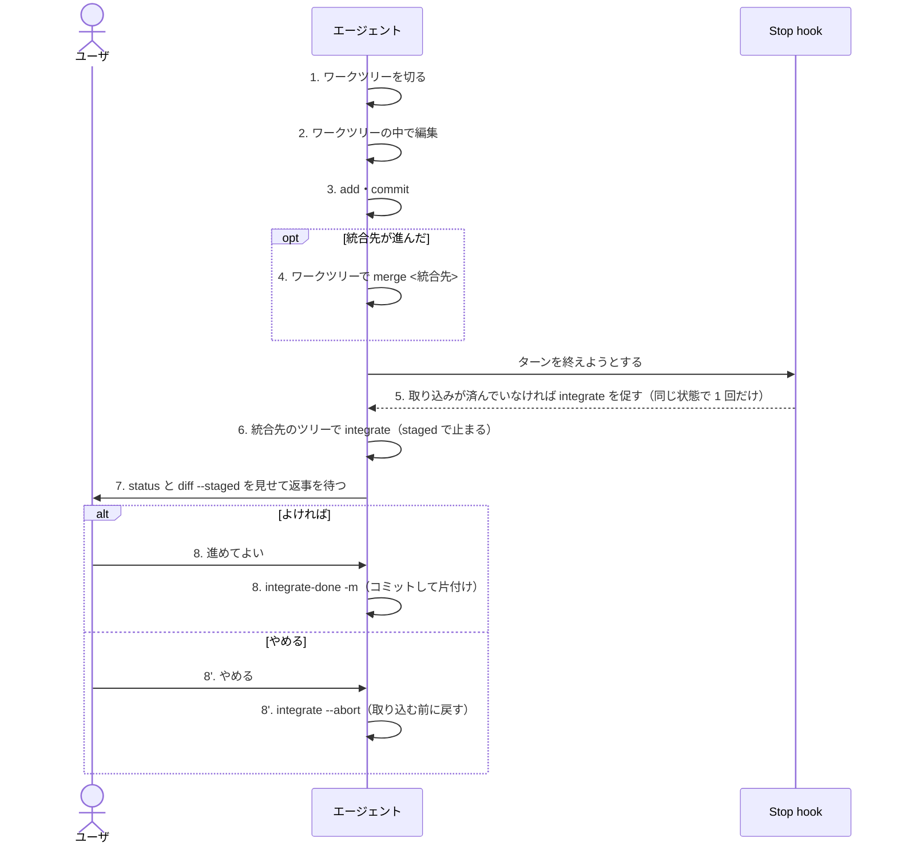

# 直接作業のユーザとエージェントの手順

直接作業は、チケットを起こさない調査・小さな修正。判定は全体ルールだけで、レビューはユーザが取り込み前の差分を見ることで行う（マージリクエストは使わない）。
チケット作業の手順は[ticket-flow.md](ticket-flow.md)。ワークツリーの一般的な決まりは[worktree.md](worktree.md)、取り込みの細部は[worktree-merge.md](worktree-merge.md)、片付けは[worktree-cleanup.md](worktree-cleanup.md)。
git は直接呼ばず `ccnavi-git.sh` を通す（生の git は常に止められる）。

## 全体の流れ

## 手順の一覧

各手順は、やること（手順）・打つもの（コマンド）・できるものと動き（成果物）の 3 行で書く。

| # | 誰 | 区分 | 内容 |
|---|---|---|---|
| 1 | エージェント | 手順 | ワークツリーを切る。名前は `<先頭の語>-<番号>-<slug>`（形が違っても、警告が出るだけで止まりはしない） |
| 1 | | コマンド | `ccnavi-worktree.sh <名前>`。ずれがあれば終了コード3で状態と確認コードを出して止まるので、ユーザの了承を得て `--base`・`--accept`・`--copy-wip`/`--no-wip`・`--side-by-side` を付けて打ち直す |
| 1 | | 成果物 | `<ワークスペースルート>/.claude/worktrees/<名前>` とブランチ `<名前>` ができる。起点は取り込み先（メインのチェックアウトが開いているブランチ）の HEAD か、`--copy-wip` で写した書きかけのスナップショット。origin からは切らず、手元の取り込み先は進めない。記録は共通の git ディレクトリの `ccnavi-direct/<名前>` に残る。同名または同じ識別子のブランチが手元か origin にあると作らず止まる |
| 2 | エージェント | 手順 | ワークツリーの中で編集する。ワークスペースルート直下（`projects/` を含む）の編集は止められる |
| 2 | | コマンド | Write・Edit |
| 2 | | 成果物 | ワークツリーの作業ツリーが変わる。`wip/handoff/`・`scratchpad/`・`.claude/worktrees/` は、ルート直下の編集を止めるルールの例外。止められたら、`ccnavi-worktree.sh` でワークツリーを切る |
| 3 | エージェント | 手順 | 変更をコミットする。`integrate` が取り込むのはコミットした分だけ | 
| 3 | | コマンド | `ccnavi-git.sh add -- <パス>`、`ccnavi-git.sh commit -m <メッセージ>` |
| 3 | | 成果物 | ブランチ `<名前>` にコミットが積まれる。`--no-verify` と `--amend` は拒否される |
| 4 | エージェント | 手順 | 統合先が進んでいたら、ワークツリーの中で統合先を取り込み、衝突を解く。解かずに `integrate` へ進まない |
| 4 | | コマンド | `ccnavi-git.sh fetch origin <統合先>`、`ccnavi-git.sh merge <統合先>` |
| 4 | | 成果物 | ワークツリーのブランチに統合先が入る（マージコミット、または衝突の解消）。`-X ours/theirs` と `-s ours/theirs` は拒否される |
| 5 | Stop hook | 手順 | ターンの終わりに、直接作業のワークツリー（cwd のもの、またはこのセッションが Write・Edit・NotebookEdit で書いたもの。チケット制御の有無は問わない）で未コミットの変更か統合先に入っていないコミットがあり、`integrate <名前>` の記録が無ければ、1 回だけ止めて `integrate` を促す。hook は `integrate` を打たない。仕組みはベストエフォートである。Bash だけで編集・コミットしたツリーは、cwd がその中にあるときだけ拾える |
| 5 | | コマンド | なし（hook の自動判定） |
| 5 | | 成果物 | 止めて理由 `NUDGE_INTEGRATE` の文を返す。同じ状態（コミットの有無・件数・HEAD）では再び言わず、進めばまた言う。未コミットの変更があるときは「先にコミットする」と言う。統合先のツリーに途中操作や未コミットの変更がある、統合先が決まらないなどのときは、止めずに理由だけ伝える。`dry-run` でも止める |
| 6 | エージェント | 手順 | 統合先をチェックアウトしているツリー（ワークスペースルートなど）で取り込む。ほかのツリーで打つと拒否され、正しい場所が出る |
| 6 | | コマンド | `ccnavi-git.sh integrate <名前>` |
| 6 | | 成果物 | `merge --squash` で、ブランチの変更が統合先ツリーの index に staged で載る（コミットはしない）。ブランチが持ち込んだ `wip/handoff/` の下書きは取り込まずに外す。記録 `.git/ccnavi-integrate/<名前>/`（`marker` と `paths`）が置かれる。衝突すると `state conflict` の記録を残して止まる。統合先のツリーに未コミットの変更や途中操作がある、取り込む側のワークツリーに未コミットの変更がある、チケットに結び付く名前、のいずれかなら拒否する |
| 7 | エージェント | 手順 | 中身をユーザに見せ、返事を待つ。コードは強制しないが、出力の案内と Stop の促しがこの手順を案内する |
| 7 | | コマンド | `ccnavi-git.sh status`、`ccnavi-git.sh diff --staged` |
| 7 | | 成果物 | staged の差分が表示されるだけで、何も変わらない |
| 8 | ユーザ | 手順 | 差分を見て、取り込むかやめるかを決める |
| 8 | | コマンド | エージェントに返事をする（自分でコミットしてもよい） |
| 8 | | 成果物 | 取り込む: 次の 9。やめる: 次の 9' |
| 9 | エージェント | 手順 | 取り込む。staged をコミットして片付ける。ユーザが自分でコミットした後なら `-m` なしで片付けだけ行う |
| 9 | | コマンド | `ccnavi-git.sh integrate-done <名前> -m <メッセージ>` |
| 9 | | 成果物 | staged が統合先のコミットになる（フックは通る）。片付けの直前に記録を `.git/ccnavi-integrate-done/<名前>` へ写して残し（7 日より古い写しは消す）、ワークツリー、ローカルブランチ、取り込みの記録を消す。リモートのブランチは扱わず、push もしない。staged が取り込んだときと違う、ブランチの先頭が動いた、ブランチの中身が統合先に入りきっていない（git が 2.38 未満のときも）なら、何も消さずに理由を出す。途中で止まったら残したものを出し、同じコマンドの打ち直しで続きから進む |
| 9' | エージェント | 手順 | 取り込みをやめる |
| 9' | | コマンド | `ccnavi-git.sh integrate --abort <名前>` |
| 9' | | 成果物 | `reset --merge` で取り込む前の状態に戻り、記録が消える。staged に取り込み以外のパスが混じっている、index が記録と違う、ときは戻さず止まる。衝突で止まったときも使う（squash の衝突は `merge --abort` では戻せない） |
| 10 | ユーザ | 手順 | 取り込んだコミットをリモートへ送るかどうかを決める |
| 10 | | コマンド | ユーザが決める（`ccnavi-git.sh push` は統合先へは送らない） |
| 10 | | 成果物 | リモートの統合先は、ユーザが送るまで変わらない |

## 気をつけること

- 直接作業のブランチは push しない。push すると手元に `origin/<名前>` ができ、`integrate` が「チケットに結び付く」と見て拒否する。ワークツリーを切る側も、origin に同名のブランチがあれば止まる。Stop の促しも同じ判定を使うので、push 済みのブランチには促しが出ない
- push 済みで `integrate` が断られたときは、リモートのブランチを消して `ccnavi-git.sh fetch origin <統合先>` などで手元の `origin/<名前>` の参照を落とすか、チケットとして起こし直す。リモートのブランチを消しても、手元の参照は取得時の掃除（`fetch --prune`）まで残る
- チケットに結び付く名前は `integrate` できない。承認済みチケット（`doing/`・`done/`）か提案（`todo/`・`review/`）に同じ名前がある、手元の退避に同じ名前の親がある、上で述べた push 済みの状態、のいずれか。判定は実行ファイルの `ccnavi tree bound` が行い、答えを得られないときも拒否する。取り込み先のブランチがチケットに結び付くかは、別に `ccnavi tree base-bound` が見る。こちらは名前ではなくブランチで判定する。チケット作業は[ticket-flow.md](ticket-flow.md)の流れでマージリクエストに出す
- 直接作業からチケット作業へ移るときは、承認の前に、提案を書いたツリーを識別子と同じ名前に切り直す。承認の後には切り直さない（[worktree.md](worktree.md)）
- 書き込めない場所を直すときは、`ccnavi-stage.sh <元のパス>` で元ファイルを、cwd のワークツリーの `wip/handoff/<ルートからの相対>` に写して編集する（`.orig` も作る。cwd がワークツリーの外ならワークスペースルートの `wip/handoff/`）。ワークツリーの下書きはブランチに載るので push でき、直接作業なら `integrate` が取り込みのときに外す。すべて直したら `ccnavi-stage.sh --commands <元のパス>` が、元と違うものについて `mv` を出す。実行するのはユーザで、元ファイルは動かさない
- この文書の実装の読みは、ソースの読解による。ワークツリーの作成・`integrate`・片付けを実機で動かして確かめてはいない
