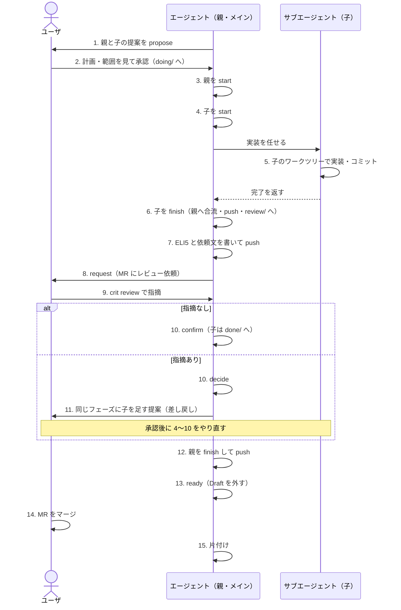

# 子チケット作業のユーザとエージェントの手順

チケット作業は、親（計画とレビュー依頼を受け持つ）と子（実装を受け持つ）に分かれる。親は計画と依頼だけをし、作業は子が行う。
各コマンドは `ccnavi-ticket.sh`・`ccnavi-review.sh`・`ccnavi-sync.sh` を通す（使い方は `--help`）。
合流と片付けの細部は[worktree-merge.md](worktree-merge.md)と[worktree-cleanup.md](worktree-cleanup.md)、
ワークツリーの切り方は[worktree.md](worktree.md)。

## 全体の流れ

## 手順の一覧

| # | 誰 | 手順 | コマンド・成果物 |
|---|---|---|---|
| 1 | エージェント | 親と子の提案を `todo/` に書き、親のブランチへ送る | `ccnavi-ticket.sh propose <識別子>` |
| 2 | ユーザ | 計画（`plan:`・待ち方）と範囲を見て承認する。承認されると提案は `approved/doing/` へ動く | `ccnavi --agree <親> <子>`、または承認画面 |
| 3 | エージェント（メイン） | 親を着手する。親のワークツリーで先に実行する | `ccnavi-ticket.sh start <親>` |
| 4 | エージェント（メイン） | 子を着手する。待つ番号がすべて閉じてレビュー済みなのが条件 | `ccnavi-ticket.sh start <子>` |
| 5 | サブエージェント | 子のワークツリーで実装し、手元でコミットだけする。合流・状態の記録・push はしない | コミット |
| 6 | エージェント（メイン） | 子を閉じる。親のブランチへの合流、`review/` への移動、push を 1 操作で行う。衝突したら子のワークツリーで親を merge して解き、やり直す | `ccnavi-ticket.sh finish <子>` |
| 7 | エージェント（親） | ELI5 の HTML と依頼文を書き、コミットして push する | `wip/eli5/phase-N.html` |
| 8 | エージェント（親） | すべての子が合流済みと確かめ、レビューを依頼する。開始時に用意した MR に依頼が付き、`requested` のマーカーが置かれる | `ccnavi-review.sh request --phase N --body-file <依頼文> --eli5 <html>` |
| 9 | ユーザ | MR を見て、`crit review` で指摘を付ける | `crit review` |
| 10 | エージェント（親） | 指摘が無ければ確定する。指摘が残れば `decide` する。子は `done/` へ移る | `confirm`、`decide` |
| 11 | エージェント（親） | 指摘があれば、同じフェーズに子を足す提案を出す（差し戻し）。承認後に 4〜10 をやり直す。`review/` の子へ後から積んだコミットは親へ入らない | 1 から |
| 12 | エージェント（親） | 親を閉じて push する。親は `done/` へ移る | `ccnavi-ticket.sh finish <親>` |
| 13 | エージェント（親のワークツリーの外から） | Draft を外す。記録の archive、`wip/` の削除、push も行う。12 から 13 まではユーザへの確認を取り直さない | `ccnavi-review.sh ready --parent <親>` |
| 14 | ユーザ | MR をマージする | ホスト側 |
| 15 | エージェント | 片付ける。子のワークツリーと合流済みの子のブランチ、親のワークツリーを消す。親のローカルブランチは、14 のマージを `ccnavi-sync.sh` が確かめた後だけ消す。取り消した子のブランチは一覧を見せて確認を取る | `ccnavi-sync.sh`、[worktree-cleanup.md](worktree-cleanup.md) |

- 計画が複数フェーズなら、フェーズごとに 4〜10 を回す。`review: none` のフェーズはユーザのレビューを飛ばす。`defer` のフェーズは、次にレビューのあるフェーズの依頼にまとまる
- 全体計画の最後のレビューが済んだら、`feedback:` を足した親の改版を承認する。指摘が無ければ `[]` で出す
- 小さい作業も同じ流れ。親は `plan: [quick]` の 1 項、子は `phase: 1` で、親 1 本と子 1 本を 1 回の承認で通す

## 詰まったとき

- 3 の `start` が通らないときは、実装に進まず、直接実装にも切り替えず、出力をユーザに報告して止まる。`start` が済んでいない親には、ターンの終わりの促し（6〜8 の抜けを止める）が働かない
- 承認済みかどうかや置き場は、ファイルを読んで推測せず `ccnavi-ticket.sh status` で確かめる
- 6〜8 の途中でユーザの許可は要らない。決まった道の次の一手として、確認を取らずに進める。本当にユーザの判断が要る問いだけを、最後に書いて終える
- 7 のあとに依頼（8）を打っていないのに、MR でレビューする、と報告しない。依頼のマーカー（`requested`）が置かれてからが、ユーザのレビュー待ち
