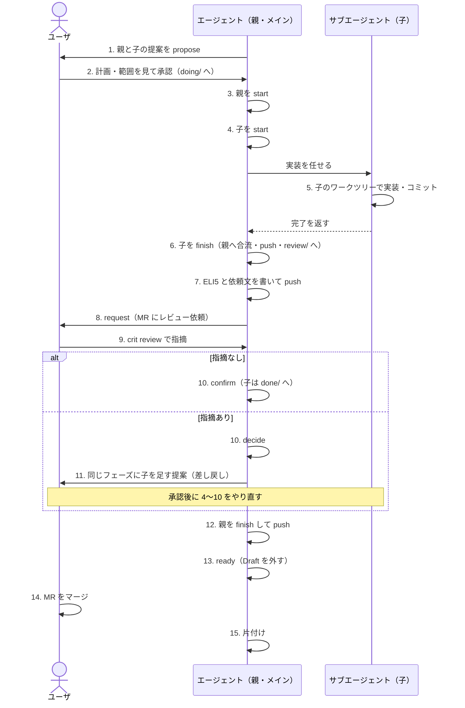

# 子チケット作業のユーザとエージェントの手順

チケット作業は、親（計画とレビュー依頼を受け持つ）と子（実装を受け持つ）に分かれる。親は計画と依頼だけをし、作業は子が行う。
各コマンドは `ccnavi-ticket.sh`・`ccnavi-review.sh`・`ccnavi-sync.sh` を通す（使い方は `--help`）。
合流と片付けの細部は[worktree-merge.md](worktree-merge.md)と[worktree-cleanup.md](worktree-cleanup.md)、
ワークツリーの切り方は[worktree.md](worktree.md)。

## 全体の流れ

## 手順の一覧

各手順は、やること（手順）・打つもの（コマンド）・できるものと動き（成果物）の 3 行で書く。

| # | 誰 | 区分 | 内容 |
|---|---|---|---|
| 1 | エージェント | 手順 | 親と子の提案を `todo/` に書き、親のブランチへ送る |
| 1 | | コマンド | `ccnavi-ticket.sh propose <識別子>` |
| 1 | | 成果物 | 提案ファイルが `todo/` に置かれ、親のブランチへ push される。まだ承認前で、判定は変わらない |
| 2 | ユーザ | 手順 | 計画（`plan:`・待ち方）と範囲を見て承認する |
| 2 | | コマンド | `ccnavi --agree <親> <子>`、または承認画面 |
| 2 | | 成果物 | 提案が `approved/doing/` へ動き、承認の日時が記録される。承認済みになるので、以後の範囲の判定はこの内容で行われる |
| 3 | エージェント（メイン） | 手順 | 親を着手する。親のワークツリーで先に実行する |
| 3 | | コマンド | `ccnavi-ticket.sh start <親>` |
| 3 | | 成果物 | 親が「着手済み」になり、共通レイヤーの設定がこのツリーにミラーされる。これが済むまで子は着手できず、ターンの終わりの促し（6〜8 の抜けを止める）も働かない |
| 4 | エージェント（メイン） | 手順 | 子を着手する。待つ番号がすべて閉じてレビュー済みなのが条件 |
| 4 | | コマンド | `ccnavi-ticket.sh start <子>` |
| 4 | | 成果物 | 子が「着手済み」になり、子のワークツリーとブランチが用意される。以後、子の書き込みは子の範囲（親・フェーズ定義の範囲以内）で判定される |
| 5 | サブエージェント | 手順 | 子のワークツリーで実装し、手元でコミットだけする。合流・状態の記録・push はしない |
| 5 | | コマンド | コミット |
| 5 | | 成果物 | 子のブランチに実装のコミットが積まれる。親のブランチにはまだ入らない |
| 6 | エージェント（メイン） | 手順 | 子を閉じる。衝突したら子のワークツリーで親を merge して解き、やり直す |
| 6 | | コマンド | `ccnavi-ticket.sh finish <子>` |
| 6 | | 成果物 | 子の先頭が親のブランチへ `merge --no-ff` で合流し、合流と状態の記録が 1 つのマージコミットになる。子の承認済みチケットに `merged_sha`（合流した子の先頭）が入り、`review/`（レビューを要しないフェーズは `done/`）へ移って push される。`review/` の子のワークツリーは残る |
| 7 | エージェント（親） | 手順 | ELI5 の HTML と依頼文を書き、コミットして push する |
| 7 | | コマンド | ファイルを書いてコミット・push |
| 7 | | 成果物 | `wip/eli5/phase-N.html` と依頼文が親のブランチに載る |
| 8 | エージェント（親） | 手順 | すべての子が合流済み（各子の `merged_sha` が親の先頭の祖先）と確かめ、レビューを依頼する |
| 8 | | コマンド | `ccnavi-review.sh request --phase N --body-file <依頼文> --eli5 <html>` |
| 8 | | 成果物 | 開始時に用意した MR に依頼文が付き、`phases/<親>/N.requested` のマーカー（先頭のコミット・MR・URL・日時）が置かれる。ここからがユーザのレビュー待ち。合流していない子が残っていると依頼は止まる |
| 9 | ユーザ | 手順 | MR を見て指摘を付ける |
| 9 | | コマンド | `crit review` |
| 9 | | 成果物 | MR に指摘のコメントが付く |
| 10 | エージェント（親） | 手順 | 指摘が無ければ確定する。指摘が残れば決める |
| 10 | | コマンド | `confirm`、`decide` |
| 10 | | 成果物 | 未解決の指摘が 0 になるとフェーズのレビュー済みのマーカーが置かれ、子が `done/` へ移る。指摘が残るときは、次の 11 に進む |
| 11 | エージェント（親） | 手順 | 指摘があれば、同じフェーズに子を足す提案を出す（差し戻し）。承認後に 4〜10 をやり直す |
| 11 | | コマンド | 1 から |
| 11 | | 成果物 | 同じフェーズに新しい子が `doing/` に加わり、`requested` のマーカーが外れる。`review/` の子へ後から積んだコミットは親へ入らない |
| 12 | エージェント（親） | 手順 | 親を閉じて push する |
| 12 | | コマンド | `ccnavi-ticket.sh finish <親>` |
| 12 | | 成果物 | 親が `done/` へ移り、push される。12 から 13 まではユーザへの確認を取り直さない |
| 13 | エージェント（親のワークツリーの外から） | 手順 | Draft を外す |
| 13 | | コマンド | `ccnavi-review.sh ready --parent <親>` |
| 13 | | 成果物 | 閉じたチケットと記録（`done/`・`phases/<親>/`・`flows/`）が `logs/archive/` へ移り、`wip/` の追跡済みファイルが消える。その削除がコミット・push され、MR の Draft が外れる。消したファイルと戻せる版（消す前の HEAD）が出力に出る |
| 14 | ユーザ | 手順 | MR をマージする |
| 14 | | コマンド | ホスト側の操作 |
| 14 | | 成果物 | 統合先にこの作業が取り込まれる |
| 15 | エージェント | 手順 | 片付ける。取り消した子のブランチは一覧を見せて確認を取ってから消す |
| 15 | | コマンド | `ccnavi-sync.sh`、[worktree-cleanup.md](worktree-cleanup.md) |
| 15 | | 成果物 | 子のワークツリーと、合流済みの子のブランチ（先頭が `merged_sha` と同じで push 済みの親に含まれるもの）、親のワークツリーが消える。親のローカルブランチは、14 のマージを `ccnavi-sync.sh` が確かめ、未 push のコミットが無いときだけ消える |

- 計画が複数フェーズなら、フェーズごとに 4〜10 を回す。`review: none` のフェーズはユーザのレビューを飛ばす。`defer` のフェーズは、次にレビューのあるフェーズの依頼にまとまる
- 全体計画の最後のレビューが済んだら、`feedback:` を足した親の改版を承認する。指摘が無ければ `[]` で出す
- 小さい作業も同じ流れ。親は `plan: [quick]` の 1 項、子は `phase: 1` で、親 1 本と子 1 本を 1 回の承認で通す

## 詰まったとき

- 3 の `start` が通らないときは、実装に進まず、直接実装にも切り替えず、出力をユーザに報告して止まる。`start` が済んでいない親には、ターンの終わりの促し（6〜8 の抜けを止める）が働かない
- 承認済みかどうかや置き場は、ファイルを読んで推測せず `ccnavi-ticket.sh status` で確かめる
- 6〜8 の途中でユーザの許可は要らない。決まった道の次の一手として、確認を取らずに進める。本当にユーザの判断が要る問いだけを、最後に書いて終える
- 7 のあとに依頼（8）を打っていないのに、MR でレビューする、と報告しない。依頼のマーカー（`requested`）が置かれてからが、ユーザのレビュー待ち
