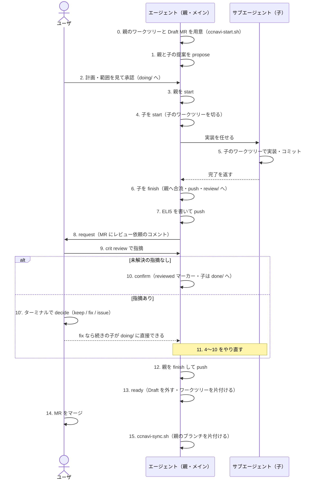

# 子チケット作業のユーザとエージェントの手順

チケット作業は、親（計画とレビュー依頼を受け持つ）と子（実装を受け持つ）に分かれる。親は計画と依頼だけをし、作業は子が行う。
各コマンドは `ccnavi-ticket.sh`・`ccnavi-review.sh`・`ccnavi-sync.sh`・`ccnavi-start.sh` を通す（使い方は `--help`）。
直接作業の手順は[direct-flow.md](direct-flow.md)。合流と片付けの細部は[worktree-merge.md](worktree-merge.md)と[worktree-cleanup.md](worktree-cleanup.md)、ワークツリーの切り方は[worktree.md](worktree.md)。
`start`・`finish`・`cancel`・`propose`・`consolidate`・`request`・`confirm`・`decide`・`ready` など状態を動かす操作は、サブエージェントからは hook が止める。打つのはメインのエージェント（`decide` はユーザ）。

## ユーザ確認までの進め方

- 判断に必要な質問・問題がない限り、ユーザ確認地点まで作業を続ける。「次へ進めてよいか」だけの確認では止まらない。ユーザが停止・待機・相談を求めた場合や、操作が拒否された場合は止まり、理由を報告する
- まず提案を書き、`ccnavi-ticket.sh propose <識別子>` で送る。内容と承認方法をユーザに案内して、承認を待つ
- 承認後は、承認範囲内の作業・検証・子の `finish`・合流確認・ELI5 作成・レビュー依頼（`ccnavi-review.sh request`）まで進める。レビュー先と ELI5 をユーザに案内して、レビュー完了を待つ
- 承認待ち・レビュー待ちの関門を越えて作業を進めない

## 全体の流れ

## 手順の一覧

各手順は、やること（手順）・打つもの（コマンド）・できるものと動き（成果物）の 3 行で書く。成果物と拒否条件は実装（`src/ccnavi/tickets/` と `.ccnavi/scripts/`）の読解による。

| # | 誰 | 区分 | 内容 |
|---|---|---|---|
| 0 前 | エージェント | 手順 | 事前確認。ホストの API（認証・リポジトリの有無・書き込みの権限）と git のリモートが使える状態かを確かめる（[worktree-start.md](worktree-start.md)）。チケット作業は必ず issue と MR のセット。issue が無ければ `ccnavi-start.sh --new-issue <題>` で作る（作れなければユーザに作ってもらう） |
| 0 前 | | コマンド | `ccnavi-start.sh --check`（0 以外なら、結果と「次:」をユーザに伝えて止まる） |
| 0 前 | | 成果物 | 何も作らない。標準出力に項目ごとの結果（OK・NG・未確認・省略・注意）と結論が出る |
| 0 | エージェント | 手順 | 親のワークツリーと MR を用意する。issue・MR を指定された作業では、ワークツリーを切る前に打つ（[worktree-start.md](worktree-start.md)） |
| 0 | | コマンド | `ccnavi-start.sh --issue <番号>`（MR なら `--mr <番号>`。`--issue` と `--mr` は一緒に渡せる） |
| 0 | | 成果物 | 親のワークツリー `.claude/worktrees/<親>`、親のブランチ、Draft MR ができ、MR が閉じる issue が確定する。出力の「必須」の行（`issue:` と `mr:`）を提案に書く。`ticket start` はこれらを作らず、無ければ `ccnavi-start.sh` を案内して止まる |
| 1 | エージェント | 手順 | `wip/proposals/todo/` に親・子の提案（と `flows/<子>.yml`）を書き、親のブランチへ送る。提案ファイルを置くのはエージェントで、`propose` はコミットして push する |
| 1 | | コマンド | `ccnavi-ticket.sh propose <識別子>` |
| 1 | | 成果物 | ロックの前に事前確認（ホストの API と git のリモート。外側の起動では確かめず、内側の 1 回だけ）を行う。全体が ok のとき、または ng が無く「api が確かめられず、権限は省略、git が ok」のときだけ続ける（後者は標準エラーに注意が出る）。それ以外は、何も書かずに終了コード 1 で止まる。標準出力には何も足さない。書いた提案だけがコミット（`ccnavi: <id> の提案を送る`）され、親のブランチへ push される。判定は承認済みのチケットだけを読むので、提案を送っても判定は変わらない。origin が無いと何も送らず案内だけ出して終わる。親のワークツリーが決まらない、提案が 0 本、置き場の外のパスが差分にある、のいずれかにヒットすると止まる |
| 2 | ユーザ | 手順 | 計画（`plan:`・先行関係）と範囲を見て承認する。ターミナルで y/N に答える。親の提案には `issue:` と `mr:` が要る |
| 2 | | コマンド | `ccnavi-user-agree.sh <親> <子>`、または承認画面 |
| 2 | | 成果物 | 提案の内容がそのまま `.ccnavi/approved/doing/<id>.md` に書かれ、`todo/` の元が消える。承認の日時はチケットに書かれず、`doing/` を足したコミットの時刻から求める。書いたパスだけがコミット・push される（統合先や保護されたブランチの上では push せず止まる）。子が既存のフェーズに加わると、そのフェーズの全マーカーが消える。検査に落ちた提案は置かれず、一部だけ通ったときは通った分を置く（終了コード 4）。承認した親のワークツリーに提案とチケットの置き場以外の未コミットの変更があれば、承認の結果で知らせる（ターミナルは標準エラーと `dirty_parent`、拡張は承認の通知の `案内:` の行）。承認は止めない。承認の後は、その変更を親のワークツリーへの書き込みでは戻せず（`DENY_TICKET_PARENT`）、子の `finish` も止まる。戻すには `ccnavi-git.sh restore --staged --worktree -- <パス>` をパス 1 つずつ名指しして打つ。残すなら子のワークツリーへ移してコミットする（[ticket-work.md](ticket-work.md)） |
| 3 | エージェント（メイン） | 手順 | 親を着手する。親のワークツリーが必要 |
| 3 | | コマンド | `ccnavi-ticket.sh start <親>` |
| 3 | | 成果物 | 先に事前確認（手順 1 と同じ。続ける条件も同じ）を行う。`doing/<親>.md` に `started_at` と `base_sha`（ワークツリーの HEAD）が書かれる。置き場は動かない。親に `project:` があれば、共通レイヤーの `rules.yml`・`phases.yml`・`risks.yml`・`rule-expectations.yml`・配点のスクリプト・`templates/*.yml` を `.ccnavi/config/common/` へコピーする（違うものだけ上書きし、共通側に無くなったものは消す）。工程スキルは `skills/` へコピーする。コピーしたら `add` してコミットする案内が出る。拒否: 親に `plan` が無い、`doing/` に無い（`todo/` なら先に承認）、着手済み、ワークツリーが無い、識別子と違う名前のワークツリーにいる、共通レイヤーをコピーできない。子の無いフェーズが残れば案内が出る（止めない） |
| 4 | エージェント（メイン） | 手順 | 子を着手する。条件は、親が着手済み、先行の子が `done/` にあること（取り消しでない）、子が未着手の `doing/` であること。先行するフェーズ（`after`）が閉じてレビュー済みかどうかは、承認時と hook のレビュー待ちの止めが確かめる |
| 4 | | コマンド | `ccnavi-ticket.sh start <子>` |
| 4 | | 成果物 | 先に事前確認（手順 1 と同じ）を行う。`doing/<子>.md` に `started_at` と `base_sha`、`phases/<親>/<子>.flow.json` にフローのハッシュが書かれる。origin があれば、sh が子のワークツリー `.claude/worktrees/<子>` とブランチを親の先頭から切る。手元に子のブランチがあって親の先頭の祖先なら親の先頭に揃え、祖先でなければ止まる。origin が無いと切らず、`ccnavi-git.sh worktree add` を案内して失敗する。以後、サブエージェントの書き込みは子の範囲で判定される |
| 5 | サブエージェント | 手順 | 子のワークツリーで実装し、手元でコミットだけする。合流・状態の記録・push はしない |
| 5 | | コマンド | コミット |
| 5 | | 成果物 | 子のブランチに実装のコミットが積まれる。親のブランチにはまだ入らない |
| 6 | エージェント（メイン） | 手順 | 子を閉じる。衝突したら子のワークツリーで親のブランチを merge して解き、コミットしてからやり直す |
| 6 | | コマンド | `ccnavi-ticket.sh finish <子>` |
| 6 | | 成果物 | 先に事前確認（手順 1 と同じ）を行う。親のワークツリーに子の先頭が `merge --no-ff` で入り、`completed_at` と `merged_sha`（合流した子の先頭）が `doing/<子>.md` に書かれ、フェーズがレビューを要するか延期なら `wip/proposals/review/<子>.md`、そうでなければ `approved/done/<子>.md` へ移る。ここまでが 1 つのマージコミット（`ccnavi: <子> の作業を終えた`）になり、親のブランチへ push される。実績リスクが `phases/<親>/<子>.risk.json` に書かれる。`done/` に移った子のワークツリーは消え、`review/` の子のワークツリーは残る。止まる条件: 親のワークツリーに状態の置き場以外の未コミットの変更がある、子のワークツリーに未コミットの変更がある、子のコミットが置き場や範囲の外を触っている、衝突、フェーズ最後の子で成果物が追跡されていない、学びの記録（`wip/handoff/learnings/<子>.md`）が子の HEAD に無い（学びの蓄積が有効なとき）、実績リスクの判定が未記録。origin が無いと合流も push もしない |
| 7 | エージェント（親） | 手順 | ELI5 の HTML を書き、コミットして push する。依頼文は任意のパスに置いてよく、コミット不要。ワークスペースルート直下の `scratchpad/` に置けば、`request` が成功したあとに消す |
| 7 | | コマンド | ファイルを書いて `ccnavi-git.sh add`・`commit`・`push` |
| 7 | | 成果物 | `wip/eli5/phase-N.html` が親のブランチに載る。依頼の前に、HEAD にコミット済みで、ワークツリーと中身が同じかを検査される |
| 8 | エージェント（親） | 手順 | すべての子が合流済みと確かめ、レビューを依頼する。MR が open の状態で既にあること（`request` は MR を作らない） |
| 8 | | コマンド | `ccnavi-review.sh request --phase N --body-file <依頼文> --eli5 <html>` |
| 8 | | 依頼文の後始末 | 依頼文は `request` の入力で、依頼したあとは要らない。レビュー待ちの間は `ccnavi-*.sh` を単独で打つ以外のシェルが止まり `rm` を打てないので、`--body-file` がワークスペースルート直下の `scratchpad/` の中のファイルなら、`request` が成功したあとに `request` 自身が消す（出力に `案内: 依頼文 … を消した`）。ワークスペースの外や `scratchpad/` 以外のファイルは消さない。消せなければ標準エラーに警告だけ出し、終了コードは変えない |
| 8 | | 成果物 | MR に依頼のコメントが 1 件投稿される（MR の説明欄は変えない。同じ目印のコメントがあれば投稿し直さない）。`.ccnavi/approved/phases/<親>/<N>.requested`（`head`・`mr`・`url`・`host`・`since`・`poster`・`at`）が置かれ、コミット・push される。ここからがユーザのレビュー待ち。止まる条件: ELI5 が未コミット・空・`wip/eli5/` の外、子が `merged_sha` を持たないか親の先頭の祖先でない、子のブランチに未合流の修正がある、親に未コミットの tracked 変更がある、親のブランチが未 push、既に依頼済み、open の MR が無い |
| 9 | ユーザ | 手順 | ELI5 と MR の差分を見て、指摘を付ける |
| 9 | | コマンド | `crit review <パス>`、`crit push <MR 番号>` |
| 9 | | 成果物 | MR にスレッドが付く。`confirm` は未解決スレッドを数える |
| 10 | エージェント（親） | 手順 | 未解決の指摘が無ければ確定する。ユーザは VS Code のボードの［レビュー完了］で済ませてもよい（0 件なら［レビュー済みにする］。エージェントへ`confirm`を打たせる文は渡さない） |
| 10 | | コマンド | `ccnavi-review.sh confirm --phase N`（親のワークツリーの中で打つ。どの親かは cwd から引く。`--parent` は `ready` だけ） |
| 10 | | 成果物 | `phases/<親>/<N>.reviewed`（`mr`・`accepted`・`actor`・`via`・`at`。手で動かした子の確定では `via: manual` と `moved`（動かした子）も）が置かれ、レビュー待ちの子が `done/` へ移り（延期で引き受けたフェーズの子も一緒に）、`done/` になった子のワークツリーが消える。止まる条件: `requested` が無い、依頼のあとに親の HEAD が動いた（`approved/`・`wip/proposals/`・`wip/eli5/` だけの変更は数えない。止めたあとに、動いたコミットの一覧（手元の git で取れたときだけ）と「ユーザが見たのは依頼時の HEAD」の説明、固定の案内「一覧にエージェントが作っていないコミットがあれば、取り込んだことをユーザに伝えてから依頼し直す」が出る）、変更要求のレビューが有効、未解決のスレッドが 1 つでもある（手で動かした子の確定では、移動の前に付いた指摘は台帳 `phases/<親>/accepted.json` に版つきで受け入れて数えない。移動の後に付いた指摘は数える） |
| 10' | ユーザ | 手順 | 指摘が残るとき、ターミナルかボードの［レビュー完了］でスレッドごとに決める。エージェントは打てない。変更要求のレビューが有効な間は通せない |
| 10' | | コマンド | `ccnavi-user-decide.sh N`（ターミナル）、ボードの［レビュー完了］（一覧の読み取りは`ccnavi-review.sh decide N --preview`） |
| 10' | | 成果物 | `keep`（対応しない）と `issue`（issue に回す。いつでも選べる。`decide` が求める前提の範囲で）のスレッドには返信が付いて解決済みになる。`fix`（このフェーズで直す）が無ければ `reviewed` が置かれる。`fix` があれば `reviewed` は置かず、続きの子 `<親>-<N>-<次の連番>` が `doing/` に直接できる（ユーザの選択が承認の代わり。先行は見た子、範囲は見た子の和、本文に指摘がコピーされる）。どちらでも、レビュー待ちの子は `done/` へ移る |
| 11 | エージェント（親） | 手順 | 指摘を直す。`decide` で `fix` を選んだなら、案内に従って新しい子のワークツリーを切り、着手する。それ以外は、同じフェーズに子を足す提案を出して承認を受ける。そのあと 4〜10 をやり直す |
| 11 | | コマンド | `ccnavi-git.sh worktree add .claude/worktrees/<新子> -b <新子> <親のブランチ>` と `ccnavi-ticket.sh start <新子>`（`fix` の場合）、または 1 から |
| 11 | | 成果物 | どちらの経路でも、そのフェーズの `requested`・`reviewed`・`pending`・`skipped` のマーカーが全部消える（消せなければ失敗として止まる）。`review/` の子のワークツリーへ後から積んだコミットは親へ入らない。未合流の修正が残ると依頼が止まる 全体計画に足す子の承認は、フィードバック計画の改版と同じ承認に入れない（両方拒まれる）。先に子を承認し、その作業と再レビューを済ませてから改版を承認する。 |
| 12 | エージェント（親） | 手順 | 全フェーズのレビューが済み、`feedback:`（`[]` 可）が出ていれば、親を閉じる。`feedback:` を初めて足す親の改版は、全体計画の最後のフェーズがレビュー済みになってから承認する（承認でレビューの状態は変わらない。手で `done/` に動かした子の確定でもよい）。MR で見るフェーズがあれば、続けて push して `ready` まで進める |
| 12 | | コマンド | `ccnavi-ticket.sh finish <親>`、`ccnavi-git.sh push` |
| 12 | | 成果物 | `completed_at` が書かれ、親が `doing/` から `done/` へ移る。`phases/<親>/closed.json`（フェーズごとの見た場所）が書かれ、コミット・push される。合流は無い。開いている子・レビュー待ちのフェーズ・未終了のフェーズ・feedback 未提出が残ると止まる |
| 13 | エージェント（親のワークツリーの外から） | 手順 | Draft を外す。ユーザが 10 でレビュー済みにした時点で合意は済んでいるので、12 からここまでは確認を取り直さない |
| 13 | | コマンド | `ccnavi-review.sh ready --parent <親>` |
| 13 | | 成果物 | `phases/<親>/ready.json` が置かれ、閉じた親子チケットと `phases/<親>/`・`flows/`が `logs/archive/<リポジトリ>/` へ移る（git 上は削除）。`wip/` の追跡済みファイルが削除され、その削除がコミット・push される（削除した一覧と、戻すときに使う削除前の HEAD が出力に出る）。MR の Draft が外れ（GitLab は題の `Draft:` を外して `squash` も有効にする）、ready のコメントが投稿される。最後に、子のワークツリー、合流済みの子のブランチ（先頭が `merged_sha` と同じで、push 済みの親に含まれるもの）、親のワークツリーが片付く。止まる条件: 親が `done/` に無い、`wip/` に未追跡ファイルがある、未コミットの変更がある、親のブランチが未 push、MR が取れない |
| 14 | ユーザ | 手順 | MR をマージする。マージ待ちかどうかは、ボードの「MR の状況を確認」（`ccnavi-review.sh mr-state <番号>`。読むだけ）で見られる |
| 14 | | コマンド | ホスト側の操作 |
| 14 | | 成果物 | 統合先にこの作業が取り込まれる |
| 15 | ユーザまたはエージェント | 手順 | 親のブランチを片付ける。マージ後の片付けは、ユーザがボードから起こすか、エージェントが打つ。取り消した子のブランチは、ユーザが確認して消す |
| 15 | | コマンド | `ccnavi-sync.sh`（ボードの［片付ける］は、確認のあと`cd <ルート> && sh <ルート>/.ccnavi/scripts/ccnavi-sync.sh <親>`をボードのターミナルへ送るだけ。取り消した子のブランチは `ccnavi-user-clean-branch.sh <子> --confirmed` をユーザが打つ） |
| 15 | | 成果物 | 親の MR がマージ済みと確かめられ、手元の親のブランチの先頭が `origin/<ブランチ>` と MR の先頭の両方に含まれるときだけ、親のローカルブランチと、ready で残った分が消える。確かめられない場合（MR が分からない）は消さない。squash で取り込まれると `branch -d` が通らないので、削除は ccnavi の実行ファイルが行う |

## 計画が複数のフェーズのとき・小さい作業のとき

- フェーズごとに 4〜10 を回す。`review: none` のフェーズはユーザのレビューを飛ばし、`defer` のフェーズは次にレビューのあるフェーズの依頼にまとまる
- 全体計画の最後のレビューが済んだら（`reviewed` が付いたら）、`feedback:` を足した親の改版を承認する。指摘が無ければ `[]` で出す。承認はレビューの状態を変えない（`reviewed` を置かず、`review/` の子も動かさない）。レビュー済みでなければ拒まれる
- 小さい作業も同じ流れ。親は `plan: [quick]` の 1 ステップ、子は `phase: 1` で、親 1 本と子 1 本を 1 回の承認で通す

## 詰まったとき

- 自分が準備・依頼したレビューの待ち中は、別の親・別の目的の新しい依頼をこのセッションで受けない。受けるときは、ワークスペースルートで起動した別のセッションで受けるようユーザに伝える。他の会話が待っている親は対象外。同じ親のレビュー対応・相談・止める指示・取り消し・次のフェーズの計画・動いている子の完了処理は、このセッションで続けてよい。これは案内だけで、セッション単位で機械的に止める仕組みではない（止めるのは、その親の cwd からのサブエージェントの起動とシェル実行だけ）。同じ文を、止めたときの案内（`hold_reason`）と `request` が成功したときの出力にも添える
- 3 の `start` が通らないときは、実装に進まず、直接実装にも切り替えず、出力をユーザに報告して止まる
- 非対話セッションで子が詰まったり、ユーザの確認が要ったりしたときは、止まる前に、メインが子を `cancel` するか、`finish` して続きの子を `propose` で送るかを決めてリモートへ反映する（手順は [ticket-work.md](ticket-work.md)）
- ターンの終わりの促し（子の `finish`・合流・ELI5・`request` の抜けと、サブエージェントが範囲外の変更を残したまま、または範囲を確かめられないまま終わったこと、手で動かして共有した子の `confirm` を止める。全体計画のレビューが済んでフィードバック計画が決まらないときも、改版を書いて `propose` で送るよう促す）は、親が着手済み（`started_at` あり）でないと効かない。未着手の親で作業すると、`finish` も `request` も打たないままターンを終えられる。同じ HEAD では 1 回だけ止め、サブエージェントが実行中の間は止めない
- 親に `project:` があると、ユーザの発言のときの同期は、共通レイヤーの `rules.yml` をコピーする前に読み直す。この読み直しは、ワークスペースルートを渡さずに `{root}` を含むルールを読むため、`` `{root}` を使うにはワークスペースルートが必要です `` で失敗する（`src/ccnavi/tickets/configsync.py` の `_unreadable_as_common`。ソースの読解で、実機では再現していない）
- 承認済みかどうかや置き場は、ファイルを読んで推測せず `ccnavi-ticket.sh status` で確かめる
- 子の `finish` から `request` までは、決まった手順の続きなので、ユーザの許可を待たずに進める。本当にユーザの判断が要る問いだけを、最後に書いて終える
- `request` を打つまでは、レビューを依頼したと報告しない。ユーザのレビュー待ちになるのは、`requested` のマーカーが置かれてから
- ホストへの送信（decide の返信・issue・コメント、close-early、request、comment、ready の補助コメント）は、`logs/state/ops/` の操作記録に段階ごとに載る。途中で失敗したら、`ccnavi-ticket.sh status` が「引き継ぎ未完了」として出す。decide は `ccnavi-user-decide.sh --resume <操作ID>` で続きを送る。送ったか確定できない段階は自動では送り直さず、ホストで目印 `ccnavi:op=<操作ID>` を探して確かめる
- ユーザが子を `review/` から `done/` へ手で動かして commit・push すると、`ccnavi-ticket.sh status` が「レビュー完了確認待ち」と言い、Stop が `ccnavi-review.sh confirm --phase N` を 1 回だけ促す（`STEP_CONFIRM`）。confirm は移動の前に付いた未解決の指摘だけを、版つきで `phases/<親>/accepted.json` に受け入れる（ホストのスレッドは解決しない）。移動の後に付いた指摘や変更要求があれば確定しない。未コミット・未 push の移動は「移動が未共有」と言って確定しない

## 操作記録と dry-run

- 未完了の操作記録（`logs/state/ops/`）は、prune で消えない。`ccnavi-ticket.sh status` で見つけて、「詰まったとき」の節の「ホストへの送信」の項目のとおりに続ける
- `dry-run` でも、チケットの操作（状態の操作）と、承認済みの置き場・操作記録への書き込みは止まる。一般のルールの `deny`・`ask` だけは止まらず、報告になる
