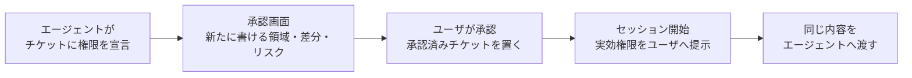
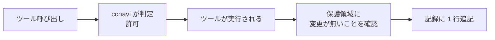
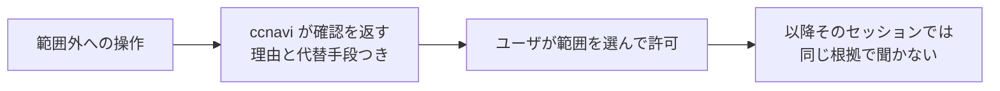
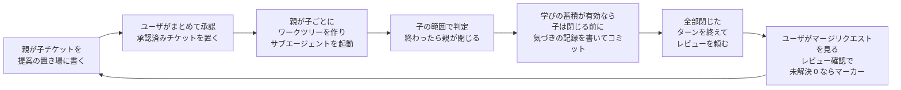

[ccnavi 要件書](../requirements.md) に戻る。

## 3. 正常な流れ

成功する筋道だけを描く。異常系は「異常時」の要求で扱う。

### 3.1 チケットの承認からセッション開始まで

### 3.2 ツール呼び出し 1 回

### 3.3 範囲外に触れたとき

### 3.4 フェーズ 1 つ

### 3.5 ユースケース

ユースケースは、誰がどんな場面で何を達成するか、を外から観測できる形で書いたものである。番号は受入シナリオ（[ユースケースとシナリオの表](../../tests/scenarios/README.md)）の UC と同じで、
その表が、各ユースケースを確かめるシナリオの有無と状態を持つ。ここには状態を写さない。

層は中心から外へ並べた分け方である。層が進むほど、人間の操作（承認・レビュー）と準備が増える。

| UC | 誰が | 場面と、達成されること | 主な要件 |
|---|---|---|---|
| UC-01 | エージェント | ワークツリーを切らずにルートを直接編集しようとすると拒否され、ワークツリーを切る案内が返る | REQ-PRE |
| UC-02 | エージェント | 生の `git` を打つと拒否され、`ccnavi-git.sh` の入口を案内される。その入口では通る | REQ-PRE |
| UC-03 | エージェント | コマンド名を変数や置換で組み立てた呼び出しは、中身を確かめられないので止まる | REQ-PRE |
| UC-04 | エージェント | 再帰的な強制削除は、直接でも `sh -c`・`env` 越しでも止まり、何も消えない | REQ-PRE |
| UC-05 | エージェント | 認証情報の場所は読めない。値を持たない見本（`.env.example`）も読めない | REQ-PRE、REQ-RUL |
| UC-06 | エージェント | ルールが言及しない呼び出しは判定せず、Claude Code の権限モードに委ねる。案内は 1 度だけ届く | REQ-PRE、REQ-HNT |
| UC-07 | エージェント | ルール・hook・スクリプトの書き換えは、Write/Edit でもシェルでも止まる | REQ-SLF |
| UC-08 | エージェント、ユーザ | 直接作業を、ワークツリー、編集、コミット、取り込み先への取り込み、片付けの順に進められる | REQ-SLF、REQ-PRE |
| UC-09 | エージェント、ユーザ | 小さい作業を、親 1・子 1 のチケットで、提案・承認・着手・完了まで進められる | REQ-APV、REQ-TKT |
| UC-10 | エージェント | 子の範囲外への書き込みは止まる。範囲を広げる道は、改版の提案に限られる | REQ-TKT、REQ-APV |
| UC-11 | ユーザ | 複数フェーズの計画（`after`・並行・終端）の承認で、計画の誤りが検査され、前のフェーズが済むまで次を承認できない | REQ-APV |
| UC-12 | ユーザ | 子を閉じるときに実績のリスクが数えられ、高いものはレビューが済むまで止まる | REQ-RSK |
| UC-13 | エージェント | ターンの終わりに、閉じ忘れた子と出していないレビュー依頼を促される | REQ-PST |
| UC-14 | ユーザ、エージェント | 保護された場所に残った変更が、実行後に検知されて知らされる | REQ-PST |
| UC-15 | ユーザ、エージェント | セッション開始のとき、実効権限が同じ内容で両方に渡される | REQ-SES |
| UC-16 | ユーザ | `ccnavi --lint`・`--test`・`--explain` で、設定の誤りと判定の理由を確かめられる | REQ-DIA |
| UC-17 | ユーザ | ワークスペースの下の複数プロジェクトを、プロジェクトごとのルールで扱える（ネストの検知を含む） | REQ-MLT |
| UC-18 | エージェント、ユーザ | 親チケットの着手で、共通レイヤーがプロジェクトの `.ccnavi/config/common/` に写される（プロジェクトのレイヤーと元のリポジトリは変わらない） | REQ-MLT |

UC-01〜07 は、止まること（何も変わらないこと）で確かめる。層は、UC-01〜06 が 1（ツール実行前のガード）、UC-07・08 が 2（自己防衛と作業の入口）、UC-09〜12 が 3（チケット作業）、
UC-13〜15 が 4（見守り）、UC-16〜18 が 5（周辺）である。
新しい機能を足したときは、ユースケースが増えるかを問い、増えるなら受入シナリオの表の UC と一緒に足す。
